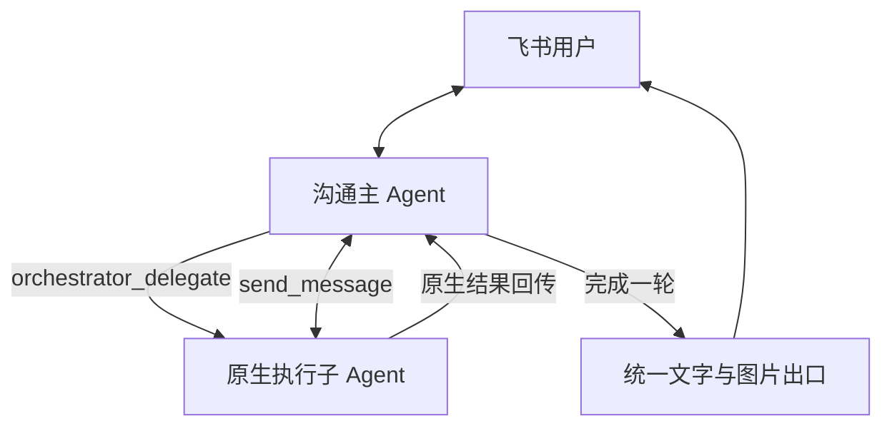

# 原生主／子 Agent 编排

通过 `conversationMode: "orchestrated"` 启用。默认仍为 `single`。此能力从 `dfy-dsh` 的原生编排实现提取，来源基线为 `84f9595b9796a8b7c357a60c8eac9f403dd84a4a`；运行与测试均只依赖本仓库和固定 DSH `0.2.1-rc.5`，不需要消费项目的源码或配置。

## 启用

新实例使用[配置示例](../examples/native-orchestration/config.example.json)，按 [README](../README.md) 构建、安装。已有实例在空闲维护窗口修改私有 profile 中 `dsh-feishu` 的配置并重启：

```json
{
  "conversationMode": "orchestrated",
  "groupPolicy": "disabled",
  "maxTurnMs": 0,
  "orchestration": { "maxActive": 2, "maxRelay": 16 }
}
```

基座按需注册 `orchestrator-frontdesk` 和 `orchestrator-worker` 预设，并在通道连接前验证。宿主需加载 DSH 原生 `subagents`、spawn provider、预设注册器及文件、Shell、jobs、skill 等对应服务；标准 `dsh-base` 提供这些服务。缺失时启动失败，不自动退回单 Agent。不要同时加载会覆盖 `send_message` 的实验性 Agent Team 预设。

首次启用会使用独立的 `-orchestrated` 会话命名空间，保留旧单 Agent 历史；关闭后恢复原命名空间。不会自动复制旧历史或复用已开始执行的旧预设。切换前停止旧消费者，保持同一应用只有一个连接。

首版飞书适配器支持私聊，要求 `groupPolicy: disabled`、`maxTurnMs: 0`。停止任务使用 `/cancel`，新会话使用 `/new`；`/status` 展示主会话、子任务执行状态和待核实投递数。自然语言取消交由主代理理解。

## 工作方式



主代理保留阅读、核验、skill 和编排工具。执行子代理使用自己的工具目录，按工作区业务指令完成操作、检查和读回。委派返回 `accepted` 后，主代理先回复，后台任务继续；后续用户消息进入同一主代理的原生 inbox。执行子代理可以向主代理提问，主代理先利用已有上下文回答，再决定是否询问用户。

子代理获得完整任务描述及显式选择的 `attachment_id`，使用独立上下文。任务目标、约束、事实、skill 路径和验收要求由主代理交接。恢复同一任务使用 `send_message`，明确取消后创建新任务。`orchestrator_tasks` 返回执行状态；业务完成以工具结果、产物和读回为准。

人设、图库、业务 skill、长期记忆、跨端共享记录及身份映射由消费项目提供。可以通过 `orchestration.frontdeskPreset`、`orchestration.workerPreset` 指定宿主中已登记的不同预设 ID，组合所需插件。基座追加通用角色职责、工具约束和附件上下文；工作区指令继续负责业务与人格。

内建主、子预设复用宿主的技能 provider，不重新启用默认用户或项目目录。标准安装继续采用 `scripts/init.mjs` 配置的工作区 `.agents/skills`；自定义宿主应先注册自己的技能目录策略。

## 审批、隔离与投递

- 子代理映射到真实的原始任务发起人及其认证消息。普通闲聊不会改写正在执行任务的授权来源；明确给原任务追加指令时更新交接。飞书业务写操作仍经过共享审批、操作凭据和读回。
- 主、子代理都保留基座工作区边界及沙箱环境。子代理 Shell 继续使用现有隔离运行器；允许的附件从真实入站资源生成，文本中的文件路径不会产生授权。
- 执行子代理隐藏并拒绝已知直接 IM 发送工具；对外表达由主会话统一交付。新业务插件继续遵守基座的审批和资源约束。
- 主代理正文中的本地 Markdown 图片由统一出口读取、上传并转换成飞书图文。支持 PNG/JPEG/GIF/WebP；每张 10 MiB、每条 10 张且合计 30 MiB。格式、范围、超限或上传错误会产生可见提示。
- 主会话回复按轮次持久化 `sending/sent/unknown/cancelled`。发送结果不明时保留 `unknown`，不自动重发。取消先撤销工具权限，再等待原生子代理停止。
- DSH 管理会话、执行循环和子代理生命周期。优雅停机会排空任务；崩溃后的任务重跑、消息重放和跨端接续不在本模块内。认证本地 `/probe` 只提交会话，不向 IM 发送。

## 扩展接口与验证

`dsh-feishu/orchestration` 导出 `createOrchestrator`（通道无关的原生编排核心）、`OrchestratedConversations` 和 `createNativeConversations`。其他通道可用可信输入绑定、任务元数据持久化与自己的统一出口组合核心；本仓库提供飞书适配器。

自定义宿主也可以通过 `Application.createConversations(deps, config, state)` 替换整个会话后端，详见[扩展契约](extensions.md)。不要同时设置内建 `conversationMode: "orchestrated"` 和自定义工厂。

```sh
python3 scripts/prepare-runtime.py
npm run test:orchestration
npm test
```

测试加载固定版本的 DSH JavaScript Agent、Session、预设和子代理 API，模型输出、审批卡和 IM 传输使用合成数据。覆盖并发沟通、追问、冷恢复、取消、附件、图片、未知投递，以及基座真实入口、请求者审批、写入回执与读回、工作区边界。不会启动 Linux CLI、读取正式凭据、连接正式飞书或部署实例。部署后的实际模型和真人收发仍需单独验收。
